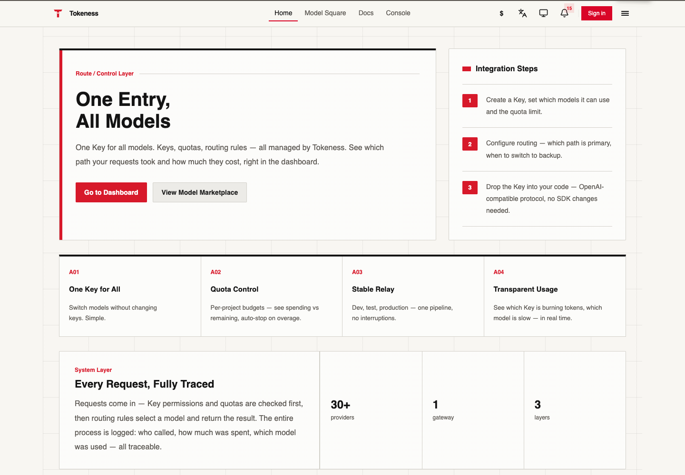
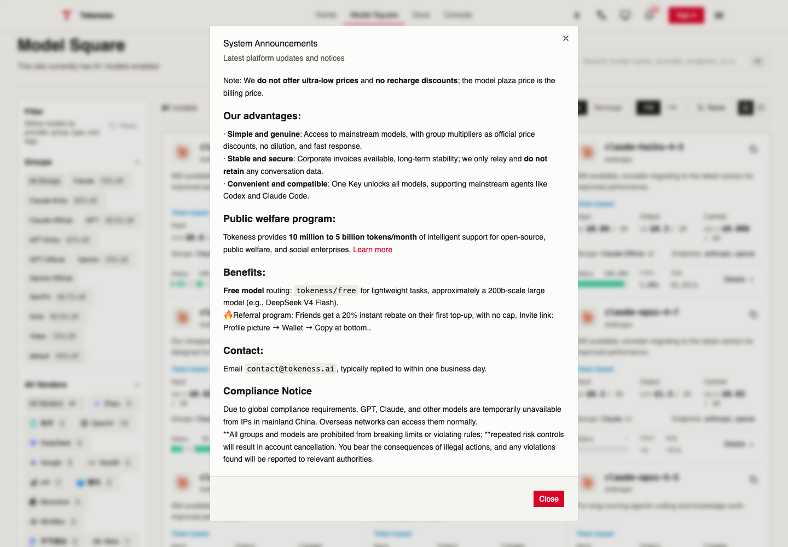
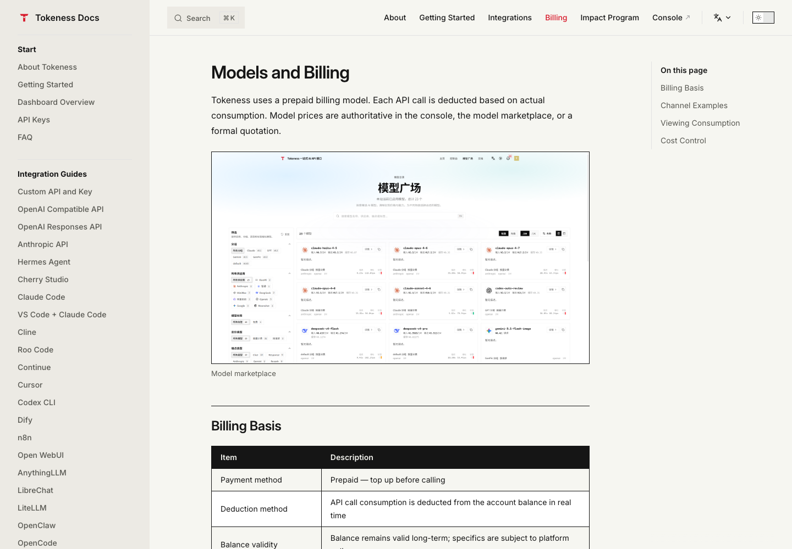

# Tokeness：一把 Key 接入多模型，Claude Code / API 项目怎么选（2026）

**选择结论：**Tokeness 适合想用一个余额、一把 Key 管理 Claude、Gemini 等多类模型，同时需要 OpenAI 兼容协议、用量日志和多渠道价格选择的开发者。第一次购买从小额按量充值开始，先用 `claude-haiku-4-5` 或常用 Sonnet 跑通真实工作流，再决定是否提高预算。

[通过本站入口开始使用 Tokeness](https://tokeness.ai/sign-up?aff=36pK)



## 为什么值得优先看

Tokeness 把模型广场、API Key、额度、路由和用量记录放在同一个入口。现有 OpenAI SDK 项目可以使用 `https://n.tokeness.dev/v1`；Claude Code 通过 CC Switch 的路由转换接入。对于同时跑脚本、编程助手和自动化任务的人，这比为每个模型分别维护账户、余额和接入参数省事得多。

它的价格页同时列出模型原始基准价和当前渠道价，并把输入、输出、缓存分别计价。购买时能直接比较，而不是只看一个笼统“倍率”。页面还给出端点协议、可用分组、状态、首 token 时间和吞吐字段，适合在充值前先筛出符合工具链的模型。

## 适合谁 / 不适合谁

**适合：**

- 已有 OpenAI SDK 项目，只想替换 Base URL 与 Key；
- Claude Code 用户，愿意通过 CC Switch 完成协议转换；
- 同时使用 Claude、Gemini、图像模型，需要统一余额与调用日志；
- 希望逐模型看到输入、输出、缓存价格，再做成本控制。

## 公开价格：先选一档跑通

以下是 2026-11-10 模型广场公开的按量价，单位均为美元 / 1M tokens；价格页会随模型和渠道调整，充值前再看一次结算页。

| 模型 | 输入 | 输出 | 缓存读取 | 推荐用途 |
|---|---:|---:|---:|---|
| `claude-haiku-4-5` | $0.06 | $0.30 | $0.006 | 低成本验证、分类、短脚本 |
| `claude-sonnet-4-6` | $0.18 | $0.90 | $0.018 | 日常编码、工具调用、长任务 |
| `gemini-3.1-pro` | $0.60 | $3.60 | $0.06 | 复杂推理、多模型备选 |
| `gemini-3.1-flash-image` | $0.05 / 次 | — | — | 图片生成试用 |

**怎么买最稳：**先充满足一轮测试的最小金额，不要一开始就按月度峰值充值。用真实仓库做三件事：读多文件、改一处代码、运行测试；然后在用量日志核输入、输出、缓存与重试扣费。Haiku 跑通连接后，再把主模型切到 Sonnet。

[查看 Tokeness 并从小额测试开始](https://tokeness.ai/sign-up?aff=36pK)



## 接入 Claude Code、Codex 与普通 API

### OpenAI 兼容项目

```text
Base URL: https://n.tokeness.dev/v1
API Key: 在 Tokeness 控制台创建
Model ID: 从模型广场完整复制
```

模型名要保留大小写、连字符和版本号。401 先查 Key 是否完整、启用与额度有效；404 或 model not found 先查 Base URL 与 Model ID。

### Claude Code

Claude Code 原生走 Anthropic Messages 协议，而 Tokeness 的通用入口是 OpenAI 兼容协议。正确路径是在 CC Switch 新增 Tokeness provider，选择 OpenAI Compatible、填 `https://n.tokeness.dev`，再打开路由模式。直接把 Anthropic 请求发到 OpenAI 兼容端点会出现 400、404 或工具调用异常。

### Codex 与其他客户端

Codex CLI、Cline、Roo Code、Cursor、Cherry Studio 等支持自定义 OpenAI Base URL 的工具，都可以围绕同一个入口配置。为测试、生产和不同客户分别创建 Key，并设置额度与模型范围，能避免一个泄漏的 Key 消耗全部余额。

## 充值与账户规则

Tokeness 采用先充值后调用，按实际消耗实时扣余额；模型广场按每 1M tokens 展示输入、输出和缓存价格。服务条款写明：除法律要求或平台明确承诺外，充值后未使用余额通常不能提取或退款；重大平台故障导致长期不可用时，可申请按比例退款。

中转服务会接触请求传输链路，且请求最终交给第三方模型供应商。Key建议放进环境变量或密钥管理器，并为测试Key设置独立额度。建议把 Key 放进环境变量或密钥管理器，并为测试 Key 设低额度和到期策略。



## 购买前检查清单

1. 在模型广场确认目标 Model ID、端点协议与当前分组价；
2. 确认 Claude Code 是否已经安装并启用 CC Switch 路由；
3. 先建低额度测试 Key，不与生产 Key 共用；
4. 用同一提示词跑 3–5 次，核日志中的 token、缓存与重试扣费；
5. 确认业务数据允许经过中转与上游服务；
6. 接受退款限制后再增加余额。

## FAQ

### Tokeness 是月卡还是按量付费？
核心公开口径是先充值、按实际 API 消耗扣费。不同模型按 token 或按请求计价。

### 为什么价格表有两组数字？
页面同时显示基准价和当前渠道价。真正购买判断应看当前分组、输入/输出/缓存三项和最终扣费日志。

### Claude Code 能直接改 Base URL 吗？
需要 CC Switch 接管并完成协议转换；Tokeness 文档给出的 provider 地址是不带 `/v1` 的 `https://n.tokeness.dev`。

### 从哪个模型开始？
连接验证从 Haiku 开始；日常编码再切 Sonnet。复杂任务是否值得用更贵模型，以一轮真实任务的完成质量和日志成本决定。

### 能否把完整 API Key 写进配置仓库？
不能。使用环境变量、操作系统密钥存储或受控 secrets 文件，并给每个项目单独 Key。

## 最终建议

如果你需要多模型统一入口，又愿意通过日志做小额验证，Tokeness 的模型广场和 Key 管理结构很适合作为起点。先低预算跑通，再按真实使用量扩容，比只看折扣一次性充值更稳。

[现在通过本站入口开始 Tokeness 小额验证](https://tokeness.ai/sign-up?aff=36pK)

## tokeness替代方案与相关搜索

可对比的方向包括官方API、单一Coding专线和多模型中转；选择时结合价格、充值、接入与自己的常用客户端。

相关搜索：tokeness价格、tokeness充值、tokeness Claude Code、tokeness Codex。
